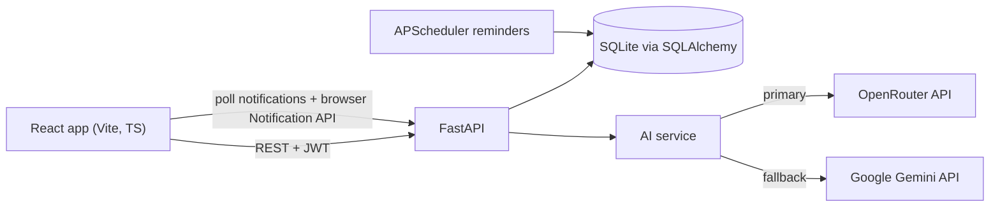

# AI Study Planner

A full-stack web app that builds a personalised study timetable with AI (via OpenRouter), tracks your progress, and helps you revise with an AI study assistant, quizzes and flashcards.

Built with **React + TypeScript (Vite)** on the frontend and **Python FastAPI** on the backend.

## Features

- **Accounts**: register and log in (JWT authentication, bcrypt-hashed passwords)
- **Subjects**: add subjects with exam date, difficulty, priority and topics
- **AI study plan**: the AI generates a two-week schedule that respects your daily hours and available days, prioritising subjects with closer exams
- **Calendar**: month, week, day and agenda views; drag a session to reschedule it, or drag its edge to change its length
- **Progress tracking**: mark sessions done or skipped, and see completion per subject, overall progress and your daily study streak
- **Study assistant chat**: ask doubts and get topic summaries; replies stream in word by word, and the assistant knows your subjects and upcoming sessions
- **Notes**: upload lecture notes (PDF, `.txt` or `.md`, up to 5 MB) or paste text, then get an AI summary, a quiz or flashcards based on those notes
- **Quizzes**: AI-generated multiple-choice quizzes with scoring and history; past quizzes can be retaken
- **Weak topics**: topics whose last three quiz scores average below 60% appear on the dashboard, with one click to add a revision session to the plan. New plans also give weak topics extra revision time
- **Flashcards with spaced repetition**: rate each card Again, Good or Easy and it comes back when you are about to forget it (an SM-2 style schedule). Keyboard shortcuts: space to flip, 1/2/3 to rate
- **Focus timer**: a Pomodoro timer (25/5 or 50/10) for any session or for free study; it records the minutes you actually studied
- **Analytics**: total study time, hours per week, time per subject, quiz average and a 20-week activity heatmap
- **Mobile friendly**: on phones the sidebar becomes a slide-out menu and the calendar opens in day view
- **Reminders**: automatic reminders 15 minutes before each session, plus your own custom reminders, shown as browser notifications
- **Light and dark mode**: a toggle in the header (and on the login page) that is remembered per browser; the first visit follows the system setting
- **Free trial and recharge**: new students get AI chat and quizzes free for 24 hours. After that a banner asks them to recharge and links to the pricing page, where they pay with Razorpay (test mode) and access is extended right away
- **Student management (admin)**: see every student, when they last logged in and how much AI they use; turn AI chat or quizzes on or off per student, extend or end access, and deactivate accounts
- **Activity log (admin)**: every login, failed login, logout and student action (plans, chats, quizzes, payments, admin changes) with time and IP address

## Architecture



- All AI calls live in `backend/app/services/ai_service.py`. [OpenRouter](https://openrouter.ai) (default model `openai/gpt-4o-mini`) is the primary provider. If OpenRouter is not configured or fails for any reason, the same request goes to Google Gemini, which tries `GEMINI_MODEL` and then `GEMINI_FALLBACK_MODEL`. You can run with either key or both.
- Prompts ask for strict JSON so plans, quizzes and flashcards can be parsed and validated.
- `backend/app/services/planner_service.py` turns the AI response into dated study sessions and creates a reminder for each one.
- A background APScheduler job runs every minute and marks reminders as due. The frontend polls for due reminders and shows them as browser notifications.

## Project structure

```
ai-study-planner/
  backend/
    app/
      core/        config, JWT and password hashing, time helpers
      db/          SQLAlchemy engine and models
      core/access.py  trial and per-feature access checks, admin guard
      routers/     auth, subjects, plans, sessions, chat, quiz, notes, focus, insights, reminders, payments, admin
      schemas/     Pydantic request and response models
      services/    AI (OpenRouter + Gemini fallback), plan building, notes text extraction,
                   weak topics, spaced repetition, analytics, activity log, Razorpay
      scheduler.py reminder background job
      main.py      FastAPI app
    tests/         pytest suite (AI calls are mocked)
    seed.py        admin account, demo student and sample subjects
    make_admin.py  promote an existing account to admin
  frontend/
    src/
      api/         axios client, endpoint functions, chat streaming, types
      components/  layout, session list, focus timer, notifications, theme toggle, topic picker
      context/     authentication state
      pages/       Dashboard, Subjects, Planner, Calendar, Chat, Notes, Quiz, Flashcards,
                   Analytics, Reminders, Pricing
      pages/admin/ Students, Activity Log, Payments
```

## Setup

### Requirements

- Python 3.11 or newer
- Node.js 20 or newer (`nvm use` picks up the version from `.nvmrc`)
- At least one AI key:
  - OpenRouter (primary) from [openrouter.ai/keys](https://openrouter.ai/keys); a typical demo costs a few cents
  - Gemini (fallback) from [Google AI Studio](https://aistudio.google.com/app/apikey), which has a free tier

### Backend

```bash
cd backend
python3 -m venv .venv
source .venv/bin/activate
pip install -r requirements.txt
cp .env.example .env          # then add OPENROUTER_API_KEY and/or GEMINI_API_KEY
python seed.py                # admin + demo accounts (see below)
uvicorn app.main:app --reload
```

The API runs at http://localhost:8000, and interactive API docs are at http://localhost:8000/docs.

### Frontend

```bash
cd frontend
nvm use
npm install
npm run dev
```

Open http://localhost:5173. If the API is not on `localhost:8000`, copy `.env.example` to `.env` and set `VITE_API_URL`.

### Accounts

`python seed.py` creates two accounts:

| Role | Email | Password |
| --- | --- | --- |
| Admin | `admin@studyplanner.com` | `admin1234` |
| Student | `demo@student.com` | `demo1234` |

Change the admin password before showing the app to anyone else. To make another account an admin, run `python make_admin.py someone@example.com`. Admins see a **Students**, **Activity Log** and **Payments** section in the sidebar and always have AI access.

### Trial and payments (Razorpay test mode)

Every new student gets `TRIAL_HOURS` (default 24) of AI chat and quizzes. When it runs out, the chat and quiz pages are locked, a recharge banner appears, and **Recharge now** opens the pricing page. Subjects, the AI planner, calendar, flashcards and reminders stay free.

To take test payments:

1. Sign up at [razorpay.com](https://razorpay.com), switch the dashboard to **Test mode** and create keys under [Account and Settings, API Keys](https://dashboard.razorpay.com/app/keys).
2. Put them in `backend/.env` as `RAZORPAY_KEY_ID` (starts with `rzp_test_`) and `RAZORPAY_KEY_SECRET`, then restart the backend.
3. On the pricing page, pay with the test card `4111 1111 1111 1111`, any future expiry date and any CVV.

The backend verifies Razorpay's payment signature before extending access, so a tampered payment is rejected. Plans and prices are defined in `backend/app/services/payment_service.py`. Without keys, the pricing page still loads but says payments are not configured, and admins can extend access by hand from the Students page.

### Tests

```bash
cd backend
source .venv/bin/activate
pytest
```

The tests use a separate SQLite database and mock the AI calls, so they don't need an API key.

## API overview

| Method | Path | Purpose |
| --- | --- | --- |
| POST | `/auth/register`, `/auth/login`, `/auth/login/json` | Create account, get JWT |
| GET, POST | `/auth/me`, `/auth/logout` | Current user (with access status), log out |
| GET, POST, PATCH, DELETE | `/subjects` | Manage subjects |
| POST | `/plans/generate` | Generate an AI study plan (replaces the previous one) |
| GET | `/plans/latest`, `/plans/progress` | Current plan, progress and streak |
| GET, PATCH | `/sessions` | List sessions, reschedule or mark done/skipped |
| GET, POST | `/chat/history`, `/chat`, `/chat/stream` | Study assistant (`/chat/stream` sends the reply as server-sent events) |
| POST | `/quiz/generate`, `/quiz/{id}/submit` | Quizzes |
| POST, GET | `/quiz/flashcards/generate`, `/quiz/flashcards/list` | Flashcards |
| GET, POST | `/quiz/flashcards/due`, `/quiz/flashcards/{id}/review` | Spaced repetition: cards due now, rate a card |
| GET, POST, DELETE | `/notes`, `/notes/{id}` | Upload, list, read and delete notes |
| POST | `/notes/{id}/summary`, `/notes/{id}/quiz`, `/notes/{id}/flashcards` | AI study tools from a note |
| POST | `/focus` | Save focus-timer minutes (optionally marking the session done) |
| GET, POST | `/insights/weak-topics`, `/insights/revision` | Weak topics, add a revision session |
| GET | `/insights/analytics` | Study time, weekly hours, heatmap and subject breakdown |
| GET, POST | `/reminders`, `/reminders/notifications`, `/reminders/{id}/read` | Reminders |
| GET, POST | `/payments/plans`, `/payments/order`, `/payments/verify`, `/payments/mine` | Plans, Razorpay checkout, payment history |
| GET, PATCH | `/admin/stats`, `/admin/students`, `/admin/students/{id}` | Admin: overview and student access control |
| GET | `/admin/activity`, `/admin/payments` | Admin: activity log and all payments |

Chat, quiz, note summary and note quiz endpoints return `402` when a student's access has ended and `403` when an admin has turned the feature off.

## Screenshots

_Add screenshots of the Dashboard, AI Planner, Calendar, Study Assistant and Quiz pages here._

## Notes

- Reminders appear while the app is open in a browser tab. Email or push reminders are out of scope.
- Session times are interpreted in the server's local timezone, which matches the user when running locally.
- Generating a new plan replaces the previous plan and its session progress. Focus-timer history is kept, so analytics still count that time.
- Scanned PDFs (images with no text layer) can't be read; upload a text PDF or paste the text instead.
- New database columns are added automatically on startup, so an existing `study_planner.db` keeps its data after upgrading. Students who registered before the trial existed start with no AI access; an admin can give them days from the Students page.
